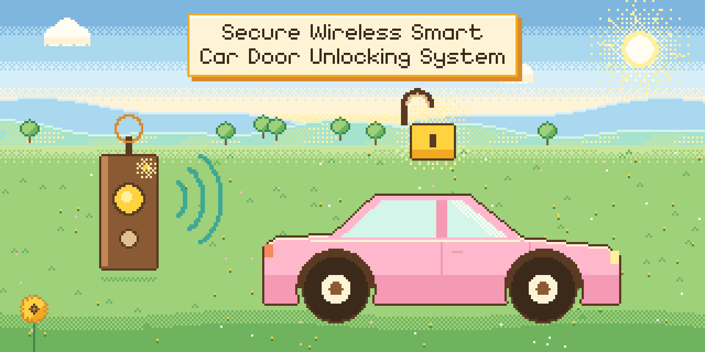

<p align="center"></p>

# Smart car door

Rolling-code car door locking over a wireless link: code and paper (Springer LNNS 528, ICICNIS 2022, [DOI](https://doi.org/10.1007/978-981-19-5845-8_8)).

## Run it

Two machines on one network, one as the car and one as the remote:

```bash
cd "Real Time Implementation using Pyfirmata"
pip install pycryptodome numpy python-dotenv
python seed_generation.py   # writes seed.json; copy it to both machines
python car.py               # on the car machine
python remote.py            # on the remote machine
```

This is the 2022 code, not maintained; [docs/about.md](docs/about.md) lists what needs changing before it runs, how it works and its limits. The 2025 rework is in [rework-2025/](rework-2025/README.md).

## Build and test

```bash
make check    # compiles the code and checks the notebooks; CI runs it
```

Cite it with `CITATION.cff` ("Cite this repository" on GitHub). Finished; see [STATUS.md](STATUS.md). MIT licence.
